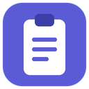
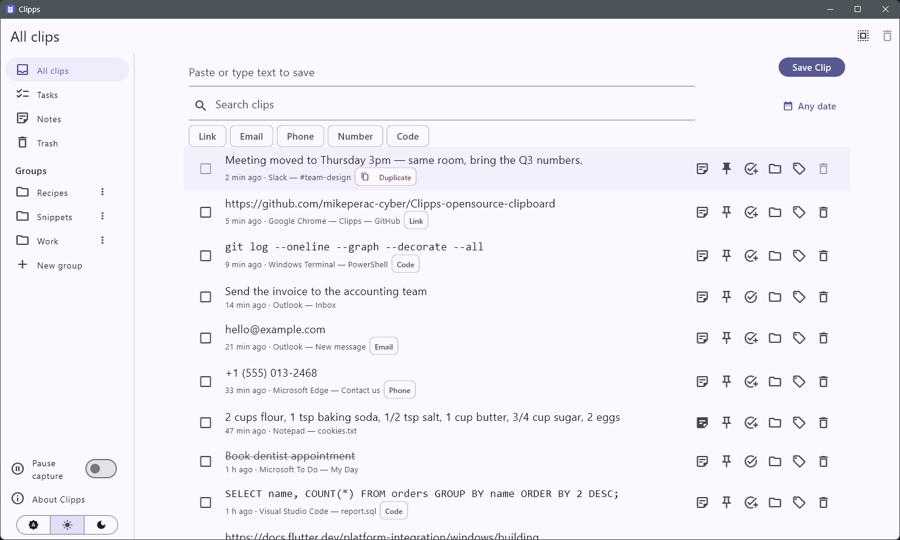

<div align="center">



# Clipps

**A fast, private clipboard history for Windows.**<br>
Everything you copy, searchable in two keystrokes. Offline. Open source.

[](https://github.com/mikeperac-cyber/Clipps-opensource-clipboard/releases/latest)
[](https://github.com/mikeperac-cyber/Clipps-opensource-clipboard/releases)
[](LICENSE)


### [⬇ Download for Windows](https://github.com/mikeperac-cyber/Clipps-opensource-clipboard/releases/latest)

<picture>
  <source media="(prefers-color-scheme: dark)" srcset="docs/images/screenshot-dark.png">
  
</picture>

</div>

## Why Clipps

- **Find anything you copied.** Press `Ctrl+Alt+.`, type a few letters, press `Enter`. The clip is back on your clipboard and Clipps gets out of the way.
- **Your data stays yours.** No account, no cloud, no analytics. Clipps never connects to the internet.
- **Organised, not just a list.** Pin, group, tag, turn clips into tasks and add notes.

## Features

| | |
|---|---|
| 🔎 **Search** | Instant search across your whole history, plus a date filter. |
| ⌨️ **Keyboard first** | `Ctrl+Alt+.` opens Clipps from anywhere, `Enter` copies the top match, `Esc` hides. |
| 🏷️ **Auto tags** | Links, emails, phone numbers, numbers and code are tagged for you. Add your own tags too. |
| 📌 **Pins & groups** | Keep important clips on top and sort the rest into groups. |
| ✅ **Tasks & notes** | Turn a clip into a to-do, or write notes about it. |
| 🔁 **Duplicate marker** | See at a glance which text you have saved more than once. |
| ⏸️ **Pause capture** | One click in the sidebar or tray when you are handling something sensitive. |
| 🔒 **Respects privacy** | Skips content that password managers mark as private, and masks detected secrets. |
| 🗑️ **Safe deletes** | Trash keeps clips for 15 days. Daily backups keep the newest 7. |
| 📤 **Export** | Save your clips to CSV from the About dialog. |
| 🌗 **Light & dark** | Follows Windows, or pick a theme yourself. |

## Install

1. Download `Clipps-Setup-x.y.z.exe` from the [latest release](https://github.com/mikeperac-cyber/Clipps-opensource-clipboard/releases/latest).
2. Run it. Clipps installs for your user only and does not need admin rights.
3. Copy something. It shows up in Clipps. Clipps starts with Windows and lives in the tray.

> **"Windows protected your PC"?** The installer is not code-signed yet, so SmartScreen may warn you. Click **More info → Run anyway**. You can also [build it yourself](#build-from-source).

Uninstalling keeps your clips in `%APPDATA%\Clipps\clipps\`, so a reinstall picks up where you left off.

## Keyboard shortcuts

| Keys | Action |
|---|---|
| `Ctrl+Alt+.` | Show or hide Clipps from any app, with the search box ready |
| `Enter` (in search) | Copy the top match and hide Clipps |
| `Esc` | Hide Clipps |

## Privacy

Clipps works offline. Your clips are stored only on this PC and are never sent anywhere. There is no account and no telemetry. The code is right here, so you can check.

## Build from source

Requirements: Windows 10 or 11, [Flutter](https://docs.flutter.dev/get-started/install/windows/desktop) (stable, 3.47 or newer) with Windows desktop support, and Visual Studio 2022 with the *Desktop development with C++* workload.

```bash
git clone https://github.com/mikeperac-cyber/Clipps-opensource-clipboard.git
cd Clipps-opensource-clipboard
flutter pub get
flutter test
flutter run -d windows
```

Release build and installer ([Inno Setup 6](https://jrsoftware.org/isinfo.php)):

```bash
flutter build windows --no-tree-shake-icons
ISCC installer\clipps.iss
```

The installer lands in `build\installer\`.

### Project layout

```
lib/database/   SQLite storage, migrations, backups
lib/providers/  App state (ChangeNotifier)
lib/screens/    UI: home, sidebar, clip rows, dialogs
lib/services/   Clipboard watcher, auto tagger, backups, CSV export
windows/runner/ Native side: clipboard listener, hotkey, tray, privacy checks
installer/      Inno Setup script
docs/           Design specs and implementation plans
```

## Your data

- Clips: `%APPDATA%\Clipps\clipps\clipps.db` (SQLite)
- Daily backups (newest 7): `%APPDATA%\Clipps\clipps\backups\`

### Restore from a backup

1. Quit Clipps from the tray icon (right-click, then **Quit**).
2. In `%APPDATA%\Clipps\clipps\`, delete `clipps.db-wal` and `clipps.db-shm` if they exist.
3. Copy `backups\clipps-YYYY-MM-DD.db` over `clipps.db`.
4. Start Clipps.

## Contributing

Bug reports, ideas and pull requests are welcome. Please [open an issue](https://github.com/mikeperac-cyber/Clipps-opensource-clipboard/issues) first for bigger changes. Before sending a PR, run `flutter analyze` and `flutter test`.

If Clipps saves you time, a ⭐ helps other people find it.

## License

[Apache License 2.0](LICENSE)
